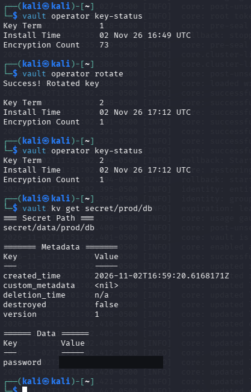
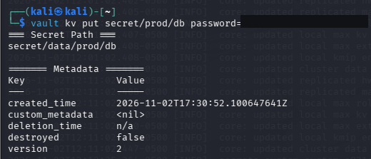
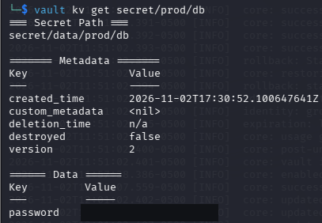

# Réponse à incident sur HashiCorp Vault

Le scénario du laboratoire commence par la découverte d’une sauvegarde de Vault copiée sur un serveur externe non sécurisé. Sur une VM Kali, l’audit de Vault a servi à retrouver un indicateur simulé. La réponse a ensuite consisté à renouveler la clé de chiffrement interne et à remplacer le mot de passe stocké dans Vault, avec une vérification de l’accès au secret après chaque opération.

Projet réalisé dans le cadre du cours **8INF882 — Gestion des incidents de sécurité** à l’UQAC, avec **Vault 2.2.1**, un stockage fichier et le moteur de secrets **KV v2**.

## Analyse et réponse

| Phase NIST SP 800-61 rév. 2 | Action et résultat |
|---|---|
| Préparation | Vault a été initialisé et déverrouillé. L’audit fichier a été activé et le secret `secret/prod/db` créé en version 1. |
| Détection et analyse | La recherche dans le journal a retrouvé une requête simulée vers `sys/key-status`, associée à l’adresse `203.0.113.200` et au jeton fictif `s.fake`. L’exposition de la sauvegarde, établie par le scénario, a motivé l’évaluation du risque de divulgation des secrets. |
| Confinement, éradication et rétablissement | La rotation a fait passer le `Key Term` de **1 à 2**. Le secret existant est resté lisible en **version 1**. Après le remplacement du mot de passe stocké, la lecture a confirmé la **version 2**. |
| Activités post-incident | Le rapport consigne les résultats, les limites des vérifications et les mesures de protection des sauvegardes. |

## Captures du laboratoire

### Entrée d’audit simulée

La commande `grep 'key-status' /vault/logs/audit.log` a retrouvé l’entrée injectée pour le TP. La capture est recadrée sur cette entrée. Le [rapport](docs/rapport-de-reponse-a-incident.md#3-détection-et-analyse) en reproduit les champs et explique comment la distinguer des requêtes locales.

### Rotation de la clé et lecture du secret existant

### Mise à jour et lecture du secret en version 2

Les valeurs des mots de passe de test sont masquées dans les captures.

## Portée des vérifications

La nouvelle clé chiffre les écritures suivantes. Les anciennes clés restent disponibles pour lire les données existantes. Une copie déjà exfiltrée reste déchiffrable si un tiers dispose du matériel nécessaire pour l’ouvrir.

La version 2 confirme la mise à jour du secret dans Vault. Le laboratoire s’arrête à la lecture de ce secret et ne couvre pas la révocation d’un identifiant sur une base de données.

## Documentation

- [Procédure de reproduction](docs/reproduire-le-laboratoire.md)
- [Rapport d’analyse et leçons apprises](docs/rapport-de-reponse-a-incident.md)
- [Configuration Vault du laboratoire](config/vault-laboratoire.hcl)
- [NIST SP 800-61 révision 2, section 3](https://nvlpubs.nist.gov/nistpubs/SpecialPublications/NIST.SP.800-61r2.pdf)
